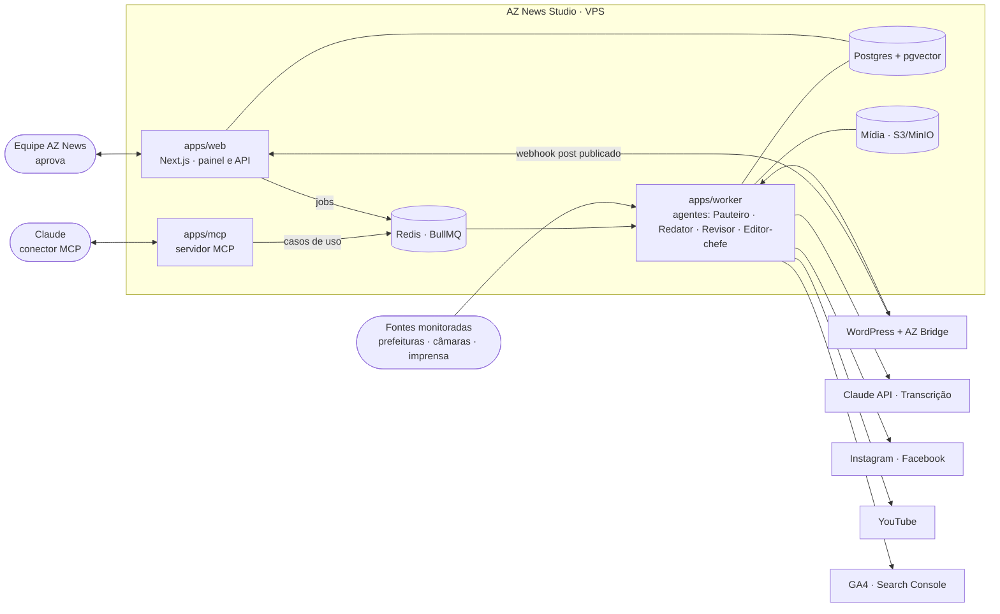

# Arquitetura

## Visão geral

O WordPress continua sendo o site público e o editor. O AZ News Studio é um app separado (Next.js + workers) cujos agentes de IA montam a pauta a partir de fontes monitoradas, escrevem e revisam as matérias, aplicam a política de autonomia e publicam no WordPress pela API REST. A equipe aprova pela caixa de aprovação ou conversando com o Claude via MCP.

## Camadas (hexagonal)

| Camada | Pacote | Conteúdo |
|--------|--------|----------|
| Domínio | `packages/core/src/domain` | Entidades, value objects, regras (crédito, aprovação, similaridade) |
| Aplicação | `packages/core/src/application` | Casos de uso; orquestram domínio + portas |
| Portas | `packages/core/src/ports` | Interfaces: `CmsPort`, `ContentFetcherPort`, `SourceCollectorPort`, `EmbeddingPort`, `LlmPort`, `SimilarityPort`, `ArticleRepository`, `JobQueuePort`, `NotificationPort`, `ClockPort`, `MediaStoragePort` |
| Adaptadores | `packages/adapters` | `WordPressRestCms`, `ReadabilityFetcher`, `PlaywrightFetcher`, `ClaudeLlm`, `PostgresArticleRepository`, `BullMqQueue`, `S3MediaStorage` |
| Entrada | `apps/web`, `apps/worker`, `apps/mcp` | Route Handlers, Server Actions, consumidores de fila, ferramentas MCP |

## Filas

| Fila | Jobs | Concorrência |
|------|------|--------------|
| `sources` | `PollSource`, `IngestItems`, `EmbedAndCluster` (repetíveis por fonte) | 4 |
| `pauta` | `ClassifyClusters`, `RankClusters`, `AutoProduce`, `BuildDailyDigest` | 1 |
| `extraction` | `ExtractSourceArticle` | 3 |
| `ai` | `RewriteArticle`, `CheckFidelity` | 2 |
| `cms` | `PublishToCms` | 1 |
| `social` | (Fase 2) | 2 |
| `video` | (Fase 4) | 1 |
| `metrics` | (Fase 3) | 1 |

Toda chamada externa tem retry com backoff exponencial (3 tentativas) e registro de custo quando aplicável.

## Glossário (domínio → código)

| Termo editorial | Código |
|-----------------|--------|
| Matéria original / fonte | `SourceArticle` |
| Matéria AZ News | `Article` |
| Versão da reescrita | `ArticleVersion` |
| Editoria | `Section` |
| Linha fina | `subtitle` |
| Nota para o editor | `editorNotes` |
| Tipo de origem | `OriginType` (`official_release`, `public_fact`, `wire`, `exclusive_report`, `exclusive_interview`, `own`) |
| Crédito no texto | `inTextCredit` |
| Alerta de fidelidade | `FidelityIssue` |
| Guia de estilo | `StyleGuide` |
| Fonte monitorada | `MonitoredSource` |
| Item coletado | `SourceItem` |
| Assunto da pauta | `StoryCluster` |
| Termos da região | `RegionalTerm` |
| Nível de autonomia | `AutonomyLevel` (`auto`, `one_tap`, `full_review`) |
| Política de autonomia | `AutonomyPolicy` |
| Caixa de aprovação | `ApprovalInbox` |

## Infraestrutura

- VPS Hostinger (KVM 4), Docker Compose + Traefik (rede `traefik-public`, certresolver `letsencrypt`).
- Código em `/var/www/az-news-studio`; compose, `.env` (chmod 600) e volumes do Postgres/Redis/MinIO em `/opt/apps/az-news-studio/`.
- Domínios: `studio.aznews.com.br` (app), `midia.aznews.com.br` (mídia pública, Fase 2).
