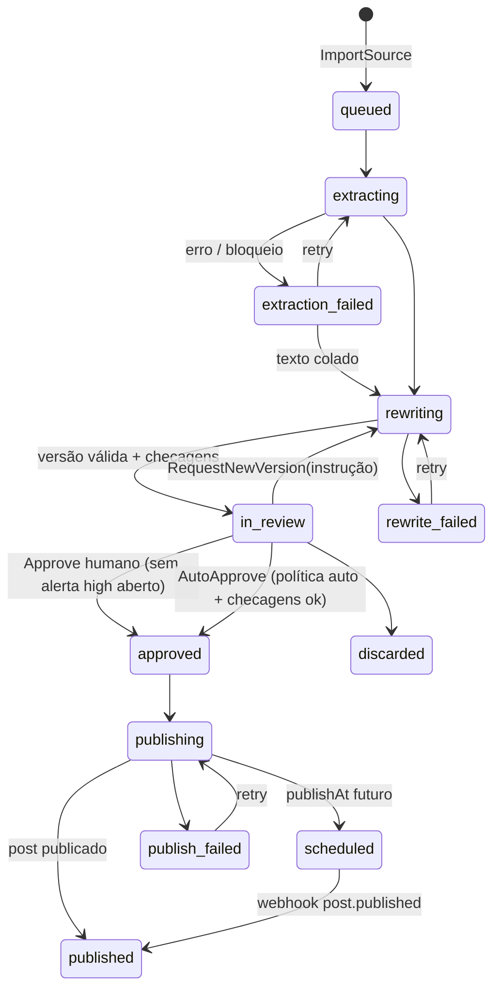

# Spec — Fase 1A: Redação (MVP)

- Status: pronta para implementação após a Fase 0
- Estimativa: 3 a 4 semanas (dedicação parcial)
- Depende de: [Fase 0](../fase-0-base/spec.md). Recebe assuntos da [Fase 1B — Fontes e Pauta](../fase-1b-pauta/spec.md)
- Referências: [ADR 0003](../../docs/adr/0003-ia-saida-estruturada-e-aprovacao.md), [ADR 0004](../../docs/adr/0004-orquestracao-agentica-e-autonomia.md), [Guia de estilo v1](../../docs/guia-de-estilo.md), [Casos de aceitação](casos-de-aceitacao.md)

## 1. Objetivo

Transformar um link, um texto colado ou um assunto da pauta (Fase 1B) em uma matéria no padrão AZ News e **publicá-la no WordPress** (imediatamente ou agendada) depois de aprovada — por um humano ou, nos casos permitidos, pela política de autonomia (ADR 0004).

**Métricas de sucesso** (medidas 2 semanas após o lançamento):
- 80% das matérias publicadas passam pelo Studio.
- Mediana de tempo de revisão humana < 5 minutos por matéria.
- 0 matéria publicada com fato não presente na fonte (auditoria por amostragem).

## 2. Escopo

### Dentro
- Importar por URL (uma ou várias), por texto colado ou a partir de um assunto da pauta (várias fontes).
- Extração (Readability; Playwright como plano B), detecção de cadeia de cópias, captura de imagens com metadados.
- Reescrita com o Claude, saída estruturada, guia de estilo versionado.
- Checagem de fidelidade, similaridade e SEO.
- Tela de revisão lado a lado, edição, nova versão com instrução, aprovação.
- **Publicação direta no WordPress** (imediata ou agendada), com categoria, tags, slug, resumo e Yoast. Sem passar pelo painel do WordPress.
- **Política de autonomia** (`auto` / `one_tap` / `full_review`), limite diário, modo sombra e pausa geral.
- **Caixa de aprovação** responsiva (PWA), com aprovação em lote e notificações.
- Imagem destacada: upload próprio ou card gerado com o título (modelo único na v1).
- Gestão do guia de estilo (versões).

### Fora (fases seguintes)
- Coleta de fontes e pauta: [Fase 1B](../fase-1b-pauta/spec.md).
- Redes sociais (Fase 2). A legenda do Instagram é gerada e exibida, mas não publicada.

## 3. Atores e permissões

| Ação | admin | editor | sales |
|---|---|---|---|
| Importar, revisar, pedir nova versão | ✓ | ✓ | – |
| Aprovar e publicar no WordPress | ✓ | ✓ | – |
| Editar políticas de autonomia, pausar automação | ✓ | – | – |
| Editar guia de estilo | ✓ | – | – |
| Ver fila | ✓ | ✓ | ✓ |

## 4. Fluxo e máquina de estados



### Invariantes (testados no domínio)

| ID | Invariante |
|---|---|
| INV-01 | `approve()` exige `approvedBy` (usuário ou `policy:<id>`) e falha se a versão atual tiver `FidelityIssue` `high` não resolvida |
| INV-02 | `approve()` falha se `similarity.ratio > threshold` e o editor não marcou "revisado manualmente" |
| INV-03 | Só uma `ArticleVersion` é `current`; editar cria nova versão (`author: human`), nunca altera a anterior |
| INV-04 | `publishToCms` só a partir de `approved`; envia `status: publish` ou `future` (com `date`) |
| INV-05 | `featuredImage.origin` = `third_party` impede o envio (só `own`, `official` com crédito, `stock`, `generated`) |
| INV-06 | Se `origin.type` ∈ {`exclusive_report`, `exclusive_interview`}, o corpo precisa conter `origin.inTextCredit` OU a nota registrar a omissão da informação exclusiva |
| INV-07 | O corpo não pode conter linha iniciada por "Fonte:" |
| INV-08 | Aprovação automática só se: nível calculado = `auto`; nenhuma `FidelityIssue` (de qualquer severidade) aberta; similaridade abaixo do limite; imagem destacada válida; automação não pausada; limite diário não atingido; regra fora do modo sombra |
| INV-09 | O nível de autonomia é o mais restritivo entre as regras aplicáveis; alerta `high` força `full_review`; editoria Política nunca é `auto` na v1 |

## 5. Casos de uso

| ID | Caso de uso | Entrada | Saída / efeito |
|---|---|---|---|
| UC-01 | `ImportSource` | `urls[]` ou `pastedText`, `section?`, `instruction?`, `userId` | Cria `Article` (`queued`) e enfileira extração (ou pula para reescrita se texto colado) |
| UC-02 | `ExtractSource` | `articleId` | `SourceArticle` salvo; detecta cadeia de cópias; captura imagens; `extracting → rewriting` |
| UC-03 | `RewriteArticle` | `articleId`, `instruction?` | Chama `LlmPort.rewrite`; valida `RewriteOutput`; calcula similaridade; chama UC-04; cria `ArticleVersion` |
| UC-04 | `CheckFidelity` | `versionId` | `FidelityReport` com `issues[]` (claim, severity, reason) |
| UC-05 | `EditVersion` | `articleId`, campos editados, `userId` | Nova versão `author: human`; recalcula similaridade e SEO (fidelidade sob demanda) |
| UC-06 | `RequestNewVersion` | `articleId`, `instruction` | Volta para `rewriting` com a instrução no prompt |
| UC-07 | `ResolveFidelityIssue` | `issueId`, `resolution` (`fixed`, `confirmed_true`, `removed`), `userId` | Marca a issue como resolvida |
| UC-08 | `ApproveAndPublish` | `articleId`, `userId`, `publishAt?` | Aplica INV-01..07; `approved`; enfileira UC-09 |
| UC-09 | `PublishToCms` | `articleId` | Converte markdown → HTML, sobe imagem, cria (ou atualiza) o post no WP com `publish`/`future`, grava `wpPostId`, `publishedUrl` e metadados `_az_studio_*` |
| UC-10 | `HandleCmsPublished` | evento do webhook | `scheduled → published`; registra também posts publicados direto no WordPress |
| UC-11 | `PublishStyleGuideVersion` | texto, `userId` | Nova versão ativa do guia |
| UC-12 | `EvaluateAutonomy` | `articleId` | Calcula o nível (INV-09); se `auto` e INV-08 ok → `AutoApprove` (ou registra "publicaria" em modo sombra); senão vai para a caixa de aprovação |
| UC-13 | `BatchApprove` | `articleIds[]` (máx. 20), `userId` | Aplica UC-08 a cada item; devolve aprovados e recusados com motivo |
| UC-14 | `DiscardArticle` | `articleId`, `userId`, motivo? | `discarded` |
| UC-15 | `PauseAutomation` / `ResumeAutomation` | `until?`, `userId` | Liga/desliga a publicação automática |
| UC-16 | `ManageAutonomyPolicies` | regras, `userId` | CRUD de regras (condições: tipo de fonte, parceira, editoria, `originType`; nível; modo sombra) |

## 6. Domínio

```ts
// Entidades e value objects principais (packages/core/src/domain)
type OriginType = 'official_release' | 'public_fact' | 'wire' | 'exclusive_report' | 'exclusive_interview' | 'own';

interface SourceArticle {
  id: SourceArticleId;
  url: string | null;          // null quando texto colado
  outlet: string | null;       // ex.: "Política Livre"
  title: string;
  subtitle: string | null;
  bodyText: string;            // texto limpo
  publishedAt: Date | null;
  byline: string | null;
  images: SourceImage[];       // url, alt, caption, credit
  copyChain: string[];         // ex.: ["Tribuna da Bahia", "Metro1", "O Globo"]
  contentHash: string;         // dedup: mesma fonte importada 2x avisa o editor
  fetchedAt: Date;
}

interface Article {
  id: ArticleId;
  status: ArticleStatus;
  sourceIds: SourceArticleId[];
  section: Section | null;
  instruction: string | null;
  currentVersionId: ArticleVersionId | null;
  featuredImage: FeaturedImage | null;   // { assetId, origin: 'own'|'official'|'stock'|'generated'|'third_party', credit }
  storyClusterId: StoryClusterId | null; // quando nasceu da pauta (1B)
  autonomyLevel: 'auto' | 'one_tap' | 'full_review' | null;
  approvedBy: UserId | `policy:${string}` | null; approvedAt: Date | null; publishAt: Date | null;
  wpPostId: number | null; publishedUrl: string | null;
  createdBy: UserId; createdAt: Date;
}

interface ArticleVersion {
  id: ArticleVersionId; articleId: ArticleId; number: number;
  author: 'ai' | 'human'; createdBy: UserId | null;
  output: RewriteOutput;                  // contrato da seção 7
  similarity: { ratio: number; matchedSpans: TextSpan[] };
  seo: SeoReport;                         // tamanhos, slug, palavra-chave
  fidelity: FidelityReport | null;
  llm: { model: string; styleGuideVersion: number; inputTokens: number; outputTokens: number; costUsd: number } | null;
}
```

## 7. Contratos (packages/contracts)

```ts
export const Section = z.enum(['Política','Vitória da Conquista','Itapetinga','Região','Bahia e Brasil','Esporte','Cultura','Serviço','Entrevistas','Opinião']);

export const RewriteOutput = z.object({
  title: z.string().min(20).max(90),
  subtitle: z.string().min(20).max(220),
  section: Section,
  tags: z.array(z.string().min(2)).min(4).max(8),
  slug: z.string().regex(/^[a-z0-9]+(?:-[a-z0-9]+)*$/).max(80),
  metaDescription: z.string().min(80).max(155),
  bodyMarkdown: z.string().min(300),
  origin: z.object({
    type: z.enum(['official_release','public_fact','wire','exclusive_report','exclusive_interview','own']),
    realOutlet: z.string().nullable(),        // primeiro da cadeia
    inTextCredit: z.string().nullable(),      // trecho exato usado no corpo
    omittedExclusiveInfo: z.array(z.string()) // o que foi omitido por ser exclusivo
  }),
  directQuotes: z.array(z.object({ text: z.string().max(160), speaker: z.string() })).max(3),
  editorNotes: z.array(z.string()).min(1),
  checklist: z.array(z.string()).min(1),
  instagramCaption: z.string().max(1200),
});

export const FidelityReport = z.object({
  issues: z.array(z.object({
    claim: z.string(),                         // trecho da nova versão
    severity: z.enum(['high','medium','low']), // high = fato ausente ou contraditório
    reason: z.string(),
  })),
});
```

> `bodyMarkdown.min(300)` é baixo de propósito: fonte curta gera matéria curta (caso B4). Nunca aumentar para forçar tamanho.

## 8. IA

- **Porta:**
  ```ts
  interface LlmPort {
    rewrite(input: { sources: SourceArticle[]; styleGuide: StyleGuide; instruction?: string; previous?: RewriteOutput; validationError?: string }): Promise<Result<{ output: unknown; usage: LlmUsage }, LlmError>>;
    checkFidelity(input: { sources: SourceArticle[]; version: RewriteOutput }): Promise<Result<{ output: unknown; usage: LlmUsage }, LlmError>>;
  }
  ```
  A validação Zod acontece no **caso de uso**, não no adaptador (o domínio decide o que é válido).
- **Adaptador `ClaudeLlm`:** SDK oficial da Anthropic, modelo em `LLM_MODEL`, saída via tool use / JSON schema gerado a partir do Zod. Timeout 90 s, 3 tentativas para erro de rede/429.
- **Prompt de reescrita:** sistema = guia de estilo ativo + regras do contrato + data de hoje em `America/Sao_Paulo` (para datas relativas). Usuário = fontes em blocos delimitados (`<fonte n="1" veiculo="..." url="..." publicada="...">`), cadeia de cópias detectada, instrução do editor, e, se for nova versão, a versão anterior e o pedido.
- **Prompt de fidelidade:** recebe as fontes e a nova versão; deve listar cada afirmação factual da nova versão que **não** está na fonte ou a contradiz. Não reescreve nada.
- **Saída inválida:** até 2 novas tentativas com o erro do Zod anexado (`validationError`). Depois disso, `rewrite_failed`.
- **Custo:** cada chamada grava tokens e custo estimado (`LLM_PRICE_INPUT_PER_MTOK`, `LLM_PRICE_OUTPUT_PER_MTOK` em env). Limite mensal `LLM_MONTHLY_BUDGET_USD`: ao atingir 100%, novas reescritas ficam bloqueadas com aviso ao admin.

## 9. Extração

1. Normalizar a URL (remover `utm_*`, `fbclid`), verificar `contentHash` de importações anteriores.
2. `ReadabilityFetcher`: `fetch` com User-Agent identificado (`AZNewsStudio/1.0 (+https://aznews.com.br)`), timeout 15 s, `@mozilla/readability` + `jsdom`. Também lê `og:*`, `article:published_time`, JSON-LD `NewsArticle`.
3. Considerar falha se o texto extraído tiver < 400 caracteres ou contiver avisos típicos ("habilite o JavaScript"). Então `PlaywrightFetcher` (Chromium headless, espera `networkidle`, mesmo pipeline).
4. Persistindo a falha (bloqueio, 403, paywall): `extraction_failed`, com a mensagem "Não foi possível ler esta página. Cole o texto da matéria." e campo de texto na UI.
5. **Cadeia de cópias** (função pura no domínio, testada): regex sobre o fim do texto e a linha de crédito — `Fonte:\s*(.+)`, `As informações são d[oa]s? (.+?)\.`, `Com informações d[oa]s? (.+?)\.`, `\(Folhapress\)`, `Por .+?/Folhapress`, `Estadão Conteúdo`, `Agência Brasil`. Resultado vai para `copyChain` e para o prompt.
6. Imagens: guardar URL, alt, legenda e crédito; **não** baixar automaticamente para o WordPress (INV-05).
7. Uma página por vez, sob ação do editor. Sem crawler.

## 10. Similaridade e SEO (funções puras)

- **Similaridade:** normalizar (minúsculas, sem acento, sem pontuação), gerar n-gramas de 8 palavras da fonte e da versão; `ratio` = palavras da versão cobertas por algum n-grama da fonte ÷ total de palavras da versão. Citações diretas declaradas em `directQuotes` são excluídas da conta. Limite padrão `SIMILARITY_THRESHOLD=0.15`. Acima do limite após a reescrita: uma nova tentativa automática com o pedido "reescreva os trechos destacados"; persistindo, alerta na revisão (INV-02).
- **SEO:** título 20–90, meta 80–155, slug ≤ 80 sem stopwords iniciais, palavra-chave (1ª tag) presente no título ou nos 2 primeiros parágrafos. Gera avisos, nunca bloqueia.

## 11. Publicação no WordPress (UC-09)

- Markdown → HTML com `marked` + sanitização (`sanitize-html`, lista branca de tags).
- Categoria: mapa `Section → wp category id` configurável na tela de Conexões (sincroniza com `GET /wp/v2/categories`).
- Tags: busca por nome; cria se não existir.
- Imagem destacada: `POST /wp/v2/media` com o arquivo do `MediaStoragePort`, `alt_text` e `caption` com o crédito.
- Metadados: `_yoast_wpseo_metadesc`, `_yoast_wpseo_focuskw` (1ª tag), `_az_studio_article_id`, `_az_studio_source_url` (1ª fonte).
- `status`: `publish`, ou `future` + `date` se `publishAt` foi definido. A opção "Salvar como rascunho no WordPress" continua disponível na tela, para casos excepcionais.
- Idempotência: se `wpPostId` já existe, atualiza (`POST /wp/v2/posts/:id`) em vez de criar outro.

## 12. Interface (apps/web)

| Tela | Conteúdo |
|---|---|
| **Caixa de aprovação** | Lista dos itens `one_tap` e `full_review`, ordenada por urgência; cada card com título, linha fina, fontes, alertas e botões "Aprovar e publicar", "Agendar", "Revisar"; seleção múltipla para aprovar em lote; layout pensado para celular (PWA, web push) |
| **Nova matéria** | Campo de URLs (uma por linha) **ou** aba "Colar texto"; editoria opcional; orientação opcional; botão "Importar" |
| **Fila** | Tabela por status com filtros (minhas, hoje, aguardando revisão); atualização em tempo real (polling 5 s ou SSE) |
| **Revisão** | Coluna esquerda: fonte (texto, veículo, data, cadeia, imagens). Coluna direita: campos editáveis da versão atual. Painel de alertas: fidelidade (com botões de resolução), similaridade (trechos destacados nas duas colunas), SEO, crédito. Nota para o editor e checklist (marcáveis). Histórico de versões com diff. Ações: "Salvar edição", "Pedir nova versão" (com instrução), "Descartar", "Aprovar e publicar" (agora ou agendado) |
| **Imagem destacada** | Upload, escolha da imagem oficial da fonte (exige crédito) ou "Gerar card com o título" |
| **Guia de estilo** | Editor markdown, versões, "Publicar nova versão" (admin) |
| **Conexões** | Status do WordPress, mapa de editorias → categorias |
| **Autonomia** | Regras de nível por fonte/editoria/origem, modo sombra, limite diário, botão de pausa geral, histórico do que foi publicado automaticamente (admin) |

## 13. Dados (novas tabelas)

`source_articles`, `articles`, `article_sources` (n:n), `article_versions` (JSONB `output`, `similarity`, `seo`, `fidelity`, `llm`), `fidelity_issues` (com `resolution`, `resolved_by`), `style_guides`, `media_assets` (`origin`, `credit`, `storage_key`), `section_category_map`, `llm_usage` (custo por chamada, para o orçamento mensal), `autonomy_policies`, `automation_state` (pausa, contagem diária), `approval_events` (quem/qual política aprovou, modo sombra), `push_subscriptions`.

## 14. Critérios de aceitação

- [ ] Os 12 casos de [casos-de-aceitacao.md](casos-de-aceitacao.md) produzem o `originType`, a decisão de crédito e as notas esperadas (teste de integração `pnpm test:acceptance`, com chamada real ao LLM, rodado manualmente; resultados salvos em `test/acceptance/report-<data>.md`).
- [ ] INV-01 a INV-07 cobertos por testes unitários no domínio.
- [ ] Página que exige JavaScript (caso B5, trbn.com.br) é extraída pelo plano B.
- [ ] Texto colado funciona do início ao fim sem URL.
- [ ] Reimportar a mesma URL avisa que ela já existe e mostra a matéria anterior.
- [ ] "Aprovar e publicar" publica no WordPress de homologação com categoria, tags, slug, resumo, Yoast e imagem destacada corretos, sem ninguém abrir o painel do WordPress; o Studio mostra a URL publicada.
- [ ] Agendamento publica no horário e o status muda para `published` via webhook.
- [ ] Regra `auto` para releases de parceiro: em modo sombra registra "publicaria"; ativa, publica sozinha respeitando o limite diário; a pausa geral interrompe na hora.
- [ ] Matéria de Política nunca é aprovada automaticamente (teste de domínio).
- [ ] Aprovação em lote de 5 itens com 1 bloqueado aprova 4 e explica o motivo do 5º.
- [ ] Orçamento mensal de LLM bloqueia novas reescritas ao ser atingido.

## 15. Tarefas (ordem sugerida, TDD)

1. Domínio: `Article` + máquina de estados + INV-01..07 (testes primeiro).
2. Funções puras: `detectCopyChain`, `computeSimilarity`, `buildSeoReport`, `markdownToSafeHtml` (testes com fixtures).
3. Contratos Zod (`RewriteOutput`, `FidelityReport`) + geração de JSON Schema para o LLM.
4. Portas: `ContentFetcherPort`, `LlmPort`, `ArticleRepository`, `MediaStoragePort`, `SimilarityPort` (se for trocar por embeddings depois).
5. Casos de uso UC-01..16 com fakes das portas; `AutonomyPolicy` com bateria de testes de precedência (INV-08, INV-09).
6. Banco: schema Drizzle e migração das tabelas da seção 13.
7. Adaptadores: `ReadabilityFetcher`, `PlaywrightFetcher`, `ClaudeLlm`, `PostgresArticleRepository`, `S3MediaStorage` (MinIO no compose), extensão do `WordPressRestCms` (media, categorias, tags, update).
8. Worker: filas `extraction`, `ai`, `cms`.
9. Web: telas da seção 12 (Caixa de aprovação como PWA, com web push).
10. Script `fixtures:fetch` e suíte `test:acceptance` com os 12 casos.
11. Gerador do card de imagem (modelo único, Satori).
12. Piloto de 1 semana com a equipe usando o Studio em paralelo ao processo manual; ajustes no guia de estilo.
