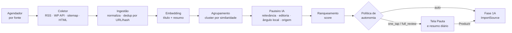

# Spec — Fase 1B: Fontes e Pauta

- Status: pronta para implementação, em paralelo ou logo após a Fase 1A
- Estimativa: 2 a 3 semanas (dedicação parcial)
- Depende de: [Fase 0](../fase-0-base/spec.md); entrega para o caso de uso `ImportSource` da [Fase 1A](../fase-1-redacao/spec.md)
- Referências: [ADR 0004](../../docs/adr/0004-orquestracao-agentica-e-autonomia.md), [Guia de estilo](../../docs/guia-de-estilo.md)

## 1. Objetivo

O Studio acompanha continuamente as fontes confiáveis escolhidas pela equipe, agrupa as notícias sobre o mesmo assunto, ranqueia o que mais interessa ao público do AZ News e entrega uma **pauta do dia** pronta: um clique transforma um assunto em matéria reescrita (Fase 1A). Para fontes parceiras com política `auto`, o assunto vira matéria e é publicado sem intervenção.

**Métricas de sucesso:**
- 70% das matérias publicadas nascem da pauta do Studio (e não de links colados).
- A pauta das 7h tem pelo menos 10 assuntos relevantes para o Sudoeste em dias úteis.
- Nenhum release de prefeitura ou câmara parceira fica mais de 2 horas sem virar matéria.

## 2. Escopo

### Dentro
- Cadastro de fontes monitoradas e de como coletar cada uma.
- Coleta periódica de **metadados** (título, link, resumo, data, imagem de capa) e de listas de "mais lidas".
- Deduplicação, agrupamento por assunto (*cluster*), classificação e ranqueamento por IA.
- Tela "Pauta" e resumo diário por e-mail e notificação.
- Produção a partir do cluster: o artigo nasce com **todas as fontes do assunto**, e a reescrita sintetiza várias fontes (melhor para originalidade do que reescrever uma só).
- Produção automática para fontes/regras com nível `auto`.

### Fora
- Baixar o texto completo das matérias na coleta (só na produção, Fase 1A, uma página por vez).
- Redes sociais como fonte (X, Instagram, grupos de WhatsApp): avaliar depois.
- Google Trends: avaliar depois (sinal opcional de popularidade).

## 3. Fontes iniciais

Os endereços e o método de cada fonte são confirmados na tarefa 2 (teste de cada coletor). Preferência: RSS > API do WordPress > sitemap de notícias > página HTML com seletores.

| Fonte | Tipo | Método provável | Parceira | Peso |
|---|---|---|---|---|
| Prefeitura de Vitória da Conquista (pmvc.ba.gov.br) | Oficial | API do WordPress ou RSS | Sim | Alto |
| Câmara de Vitória da Conquista | Oficial | A confirmar | Sim | Alto |
| Prefeitura de Itapetinga (itapetinga.ba.gov.br) | Oficial | A confirmar | Sim | Alto |
| Câmara de Itapetinga (itapetinga.ba.leg.br) | Oficial | A confirmar | Sim | Alto |
| Governo da Bahia (Secom) | Oficial | RSS / HTML | Não | Médio |
| Política Livre | Imprensa regional | RSS (WordPress) | Não | Alto |
| Correio (correio24horas.com.br) | Imprensa regional | RSS | Não | Médio |
| G1 Bahia e G1 Política | Imprensa nacional | RSS | Não | Médio |
| UOL Notícias | Imprensa nacional | RSS | Não | Baixo |
| CNN Brasil | Imprensa nacional | RSS / sitemap | Não | Baixo |
| Google Notícias — busca "Vitória da Conquista", "Itapetinga", "Sudoeste baiano" | Agregador | RSS de busca | Não | Médio |

Outras sugestões para avaliar com o Gildásio: Bahia Notícias, Blog do Anderson, Jornal do Sudoeste, sites das câmaras e prefeituras das cidades vizinhas (Belo Campo, Barra do Choça, Poções, Itambé, Caatiba, Potiraguá), portais das universidades (Uesb, Ifba).

## 4. Regras de coleta (boa vizinhança e direito autoral)

1. Só metadados e resumo na coleta; texto completo apenas quando o assunto é escolhido para produção.
2. Respeitar `robots.txt`; User-Agent identificado (`AZNewsStudio/1.0 (+https://aznews.com.br)`); `ETag`/`If-Modified-Since`; intervalo mínimo por fonte (padrão 15 min; portais nacionais 30 min).
3. Nunca contornar paywall, login ou bloqueio. Fonte que bloqueia é desativada com aviso.
4. Assuntos de origem exclusiva de outro veículo seguem as regras de crédito do guia de estilo e nunca recebem nível `auto`.
5. Fontes oficiais têm prioridade como **fonte primária**: se o mesmo assunto aparece no portal da prefeitura e num jornal, a reescrita parte do release oficial.

## 5. Fluxo



## 6. Domínio

```ts
type CollectorKind = 'rss' | 'wordpress_api' | 'news_sitemap' | 'html_list' | 'google_news_query';
type SourceTrust = 'official' | 'regional_press' | 'national_press' | 'aggregator';

interface MonitoredSource {
  id: MonitoredSourceId; name: string; homepage: string;
  kind: CollectorKind; config: CollectorConfig;      // url do feed, seletores, query
  trust: SourceTrust; weight: number;                // 0..1
  isPartner: boolean;                                 // cliente do AZ News
  defaultSection: Section | null;
  popularListUrl: string | null;                      // página "mais lidas", se houver
  pollIntervalMinutes: number; active: boolean;
  health: { lastPolledAt: Date | null; lastError: string | null; consecutiveFailures: number };
}

interface SourceItem {
  id: SourceItemId; sourceId: MonitoredSourceId;
  url: string; canonicalUrl: string; title: string; summary: string | null;
  imageUrl: string | null; publishedAt: Date | null; fetchedAt: Date;
  contentHash: string; isPopular: boolean;            // apareceu em "mais lidas"
  clusterId: StoryClusterId | null;
}

interface StoryCluster {                               // "assunto" na pauta
  id: StoryClusterId; headline: string; summary: string;
  itemIds: SourceItemId[]; firstSeenAt: Date; lastSeenAt: Date;
  classification: {
    relevance: number;                                // 0..1 para o público do AZ News
    section: Section; localAngle: string | null;      // ex.: "afeta servidores de Conquista"
    likelyOrigin: OriginType; isExclusiveOfOutlet: string | null;
    reasons: string[];
  } | null;
  score: number; scoreBreakdown: Record<string, number>;
  autonomyLevel: 'auto' | 'one_tap' | 'full_review' | null;
  status: 'new' | 'selected' | 'dismissed' | 'produced' | 'expired';
  articleId: ArticleId | null;
}
```

### Invariantes

| ID | Invariante |
|---|---|
| INV-P01 | Um `SourceItem` pertence a no máximo um cluster |
| INV-P02 | Cluster com `isExclusiveOfOutlet` preenchido nunca recebe nível `auto` |
| INV-P03 | Cluster sem nenhuma fonte `official` nunca recebe nível `auto` na v1 |
| INV-P04 | Clusters sem item novo há 48 h passam a `expired` |
| INV-P05 | Produzir um cluster cria **um** `Article` com todas as URLs do cluster, fontes oficiais primeiro |

## 7. Agrupamento e ranqueamento

- **Embeddings:** porta `EmbeddingPort`. A API do Claude não gera embeddings; v1 com modelo local multilíngue (`multilingual-e5-small` via transformers.js no worker, sem custo por chamada). Alternativa: Voyage AI. Vetores no Postgres com **pgvector**.
- **Agrupamento:** item novo entra no cluster ativo (últimas 48 h) mais próximo se a similaridade do cosseno for ≥ 0,82 (configurável); senão cria cluster novo. O Pauteiro confirma junções duvidosas (0,75–0,82) com uma pergunta curta ao LLM.
- **Classificação (Pauteiro):** em lote, com modelo rápido (`LLM_MODEL_FAST`), recebendo título e resumo dos itens do cluster, a lista de cidades e personagens da região (`regional_terms`, editável) e o posicionamento do AZ News. Saída validada por Zod.
- **Score** (0–100), pesos editáveis:

| Componente | Peso padrão | Cálculo |
|---|---|---|
| Relevância regional | 35 | `classification.relevance` |
| Cobertura | 20 | log do nº de fontes distintas no cluster |
| Popularidade | 15 | algum item em "mais lidas" ou em várias buscas do Google Notícias |
| Frescor | 15 | decaimento com meia-vida de 6 h |
| Peso da fonte | 10 | maior `weight` entre as fontes do cluster |
| Parceiro | 5 | alguma fonte `isPartner` |
| Já coberto | −100 | assunto já publicado pelo AZ News nas últimas 72 h (similaridade com matérias do WordPress) |

## 8. Casos de uso

| ID | Caso de uso | Efeito |
|---|---|---|
| UC-P01 | `PollSource` | Executa o coletor da fonte, atualiza `health` |
| UC-P02 | `IngestItems` | Normaliza, deduplica (URL canônica + hash), salva |
| UC-P03 | `EmbedAndCluster` | Gera embedding e associa ao cluster |
| UC-P04 | `ClassifyClusters` | Pauteiro classifica clusters novos ou alterados |
| UC-P05 | `RankClusters` | Recalcula scores; aplica política de autonomia |
| UC-P06 | `ProduceFromCluster` | Chama `ImportSource` (1A) com as URLs do cluster; `selected → produced` |
| UC-P07 | `DismissCluster` | Descarta, com motivo opcional (alimenta ajuste futuro de pesos) |
| UC-P08 | `ManageSources` | CRUD de fontes, "testar fonte", pausar |
| UC-P09 | `BuildDailyDigest` | Às 7h e às 13h: e-mail e notificação com os 10 melhores assuntos e a fila de aprovação |
| UC-P10 | `AutoProduce` | Para clusters com nível `auto`: produz sem clique (respeitando limite diário e modo sombra) |

## 9. Interface

| Tela | Conteúdo |
|---|---|
| **Pauta** | Cards ordenados por score: título, resumo, fontes (com selo "oficial"/"parceira"), "por que é relevante", editoria e ângulo local sugeridos, detalhamento do score. Ações: **Produzir**, Descartar, Juntar com outro, Separar. Filtros: editoria, cidade, só parceiros, só novos |
| **Fontes** | Lista com status (última coleta, erros), criar/editar, "testar fonte" (mostra os 5 últimos itens coletados), pausar |
| **Termos da região** | Cidades, bairros, órgãos e personagens que aumentam a relevância (ex.: "Sheila Lemos", "Câmara de Itapetinga", "Uesb") |

## 10. Dados

`monitored_sources`, `source_items` (com `embedding vector(384)`), `story_clusters`, `cluster_items`, `regional_terms`, `ranking_weights`, `cluster_dismissals`. Extensão `pgvector` no Postgres (imagem `pgvector/pgvector:pg16` no compose).

## 11. Critérios de aceitação

- [ ] As fontes da seção 3 com método confirmado coletam sem erro por 48 h seguidas.
- [ ] A mesma notícia publicada por 3 fontes aparece como **um** assunto com 3 fontes.
- [ ] Release novo da Prefeitura de Conquista aparece na pauta em até 20 min após a publicação.
- [ ] Clicar em "Produzir" cria um artigo da Fase 1A com todas as fontes do assunto e o release oficial como fonte primária.
- [ ] Regra `auto` em modo sombra registra "publicaria" sem publicar; fora do modo sombra, publica e aparece no resumo diário.
- [ ] Fonte com 5 falhas seguidas é pausada e o admin é avisado.
- [ ] Assunto já publicado pelo AZ News nas últimas 72 h não aparece no topo.

## 12. Tarefas (ordem sugerida, TDD)

1. Domínio: `MonitoredSource`, `SourceItem`, `StoryCluster`, invariantes, cálculo do score (testes).
2. Coletores (`SourceCollectorPort`): RSS/Atom, WordPress API, sitemap de notícias, HTML com seletores, busca do Google Notícias. Testar cada fonte da seção 3 e registrar o método confirmado.
3. Normalização de URL e deduplicação (funções puras).
4. `EmbeddingPort` com modelo local; pgvector; agrupamento.
5. Pauteiro: prompt, contrato Zod `ClusterClassification`, lote com modelo rápido.
6. Agendador por fonte no worker (BullMQ *repeatable jobs*), backoff e pausa automática.
7. Integração com a política de autonomia e com `ImportSource` (1A).
8. Telas Pauta, Fontes, Termos da região.
9. Resumo diário (e-mail + web push).
10. Uma semana em modo observação: a equipe compara a pauta do Studio com o que publicou e ajusta pesos e termos.
